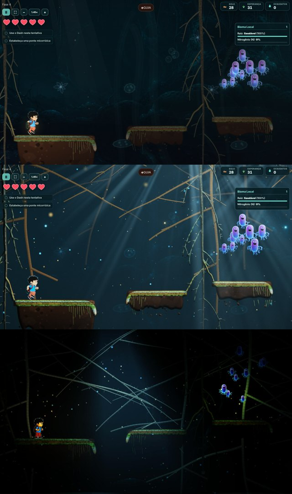
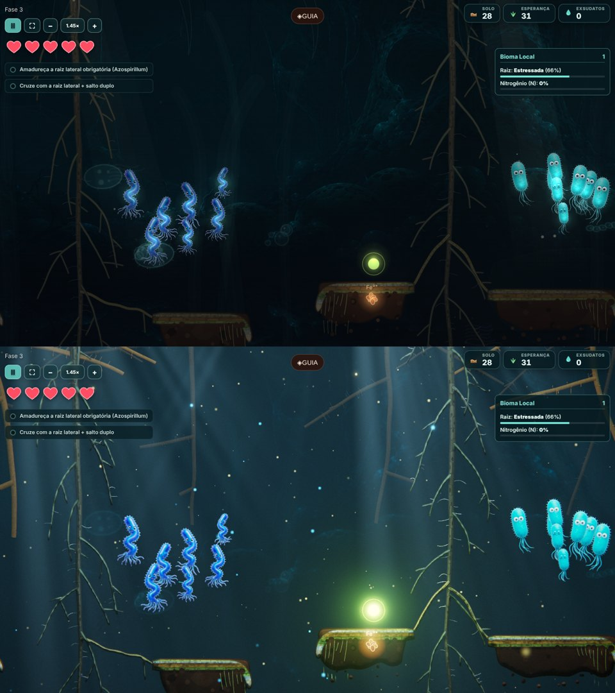
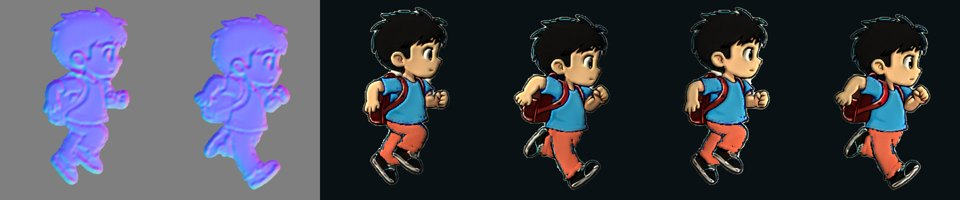
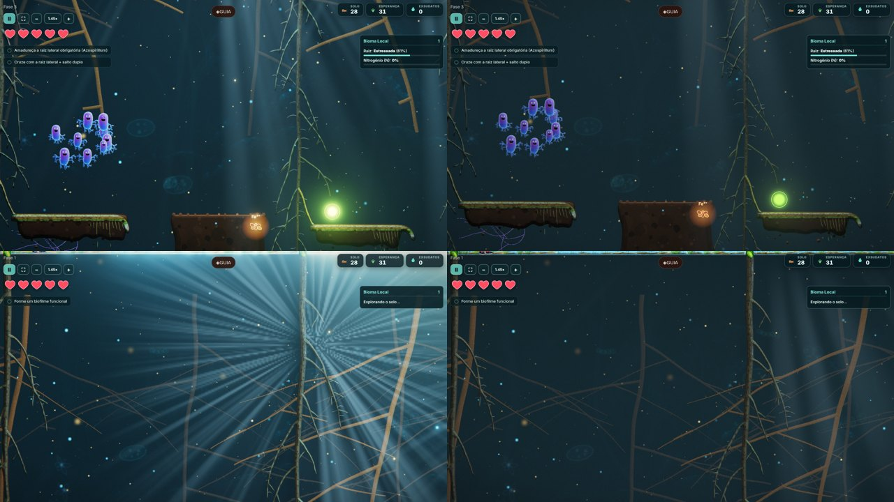
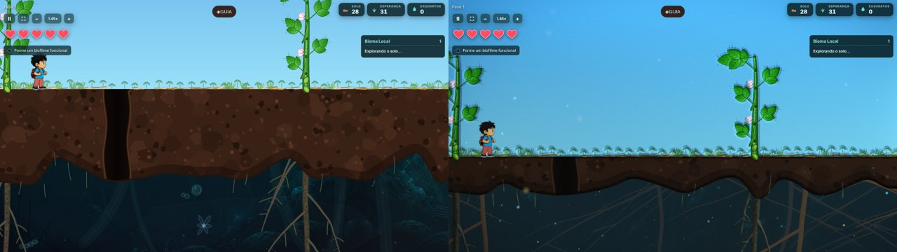

# Miguelito 2,5D — prova de conceito

Branch `experimental/visual-2_5d`. A `main` e a versão publicada não foram tocadas.

Objetivo: medir quanto o visual do jogo pode evoluir para 2,5D — luz dinâmica,
sombras, profundidade, partículas, normal maps, paralaxe e crescimento orgânico
de raízes e hifas — **sem redesenhar personagens e sem mexer na física, na geração
procedural nem nas regras biológicas**, e decidir se a Unity compensa abandonar o
motor atual.



*Fase 4, mesmo trecho e mesma seed. De cima para baixo: 2D original, WebGL 2,5D
(este experimento) e Unity URP 2D (cena exportada do jogo).*

---

## 1. Como testar

### WebGL (o jogo inteiro, dez fases)

```powershell
git checkout experimental/visual-2_5d
python -m http.server 8000
```

Abra `http://127.0.0.1:8000/?render=25d`.

| Tecla / controle | Efeito |
|---|---|
| **G** | alterna 2,5D e 2D original no mesmo quadro |
| **V** | mostra ou esconde o painel 2,5D |
| Painel → *Fase* | pula para qualquer fase (habilidades liberadas) |
| Painel → caixas | liga e desliga cada efeito, para ver o que cada um acrescenta |
| `?q=low` | menos partículas (teste em celular) |
| `?render=2d` | força o renderizador original |

Sem `?render=25d` o jogo carrega exatamente como na `main`: o Three.js nem é baixado.

Versão em pacote único (para hospedar em qualquer lugar):
`node experimental/2_5d/tools/build-web-demo.cjs <pasta>` (precisa do `esbuild`).

### Unity URP 2D (cena da fase 4)

O projeto já está criado no seu computador em `UnityProjects\Miguelito25D`
(Unity 2022.3.44f1, modelo *Universal 2D*). Abra pelo Hub, a cena
`Assets/Miguelito25D/Scenes/Rizosfera25D` abre sozinha; aperte **Play**.
Setas/A-D andam, Espaço/W pula (pulo duplo liberado), Shift dá o dash.

Para recriar do zero: crie um projeto *Universal 2D* e rode
`bash experimental/2_5d/unity/setup_unity_project.sh <repo> <projeto>`; ao abrir,
o menu **Miguelito → Montar cena 2,5D** importa tudo e monta a cena.

---

## 2. O que o código atual permite

Inspeção do repositório (137 módulos JS, ~54 mil linhas em `src/`, 72 arquivos de
teste com ~25 mil linhas):

- **A simulação já é independente do desenho.** `createSimulator()` roda em Node
  sem DOM (`setInputs` + `step(dt)`); a geração procedural (`generateLevel`,
  `decorateCampaignLevel`) também. Testado durante o experimento: Miguelito anda
  com a física real em níveis gerados das fases 2, 4 e 5 sem navegador.
- **O desenho é Canvas 2D imediato**, espalhado em ~20 subsistemas
  (`sim.ecology.render(ctx)`, `mycorrhiza.render(ctx)`, `ralstoniaControl.render(ctx)`…),
  43 arquivos e ~3.300 linhas que chamam `ctx`.
- **Os sprites passam todos por `drawImage`** com a transformação do contexto
  (posição, rotação, espelhamento e quadro já decididos pelo código do jogo).

Isso definiu a estratégia: não reescrever os desenhos, e sim mudar **para onde**
eles vão.

---

## 3. Implementação WebGL (Three.js)

Mudança no jogo: 113 linhas em `app.js` (todas atrás de `?render=25d`) e 11 em
`renderer.js`, que separam `render()` em `prepareFrame()` + desenho sem mudar a
ordem no 2D. O resto está em `experimental/2_5d/gl/` (~1.800 linhas).

| Peça | Arquivo | O que faz |
|---|---|---|
| Comutador de camadas | `layer-switch.js` | o renderizador do jogo desenha num contexto "desviável"; cada parte do quadro vai para uma camada |
| Três camadas | `app.js → drawWorldLayers25D` | **fundo** (`drawBackground`), **terreno** (`platformVisuals`), **efeitos** (todos os `render(ctx)`), na mesma ordem do 2D |
| Ponte de sprites | `ctx-bridge.js` | intercepta só os `drawImage` das folhas do Miguelito e dos organismos e os transforma em quads na GPU, com a posição/rotação/espelho do próprio jogo |
| Normal maps | `sprite-normals.js`, `tools/generate_normals.py` | relevo gerado **da própria arte**: alfa vira volume, luminância vira detalhe. Aceita `<folha>_n.png` pintado à mão com `?normais=arquivo` |
| Luz | `shading.js` | até 24 luzes pontuais por quadro: feixes da superfície, lanterna do Miguelito, exsudatos, checkpoints, objetivo e bioluminescência dos organismos (colônia = uma luz) |
| Terreno relido pela luz | `renderer-25d.js` | o desenho orgânico do jogo (células, solo, pedras) ganha normal derivada no shader: borda superior acende, miolo recebe oclusão |
| Sombras 2D | `renderer-25d.js` | máscara de oclusão (terreno + sprites) e marcha de raio para 4 luzes por quadro |
| Feixes volumétricos | `renderer-25d.js` | dispersão em tela a partir das fissuras da superfície, cortada pelas plataformas |
| Profundidade | câmera em perspectiva | o plano z=0 coincide pixel a pixel com a vista 2D; camadas em z<0 têm paralaxe real, névoa e perda de saturação |
| Crescimento orgânico | `growth.js` | raízes (gravitropismo, laterais plagiotrópicas, pelos radiculares na zona de maturação, coifa clara) e hifas (ramificação subapical, ponta ativa luminosa). Coletar um exsudato dispara hifas e uma raiz lateral |
| Partículas | `particles.js` | poeira mineral, esporos e detritos em três profundidades, iluminados pelas mesmas luzes |
| Pós | `renderer-25d.js` | bloom, ACES, correção de cor, vinheta, grão |
| Superfície | `renderer-25d.js` | na abertura da fase 1 e na cinemática final a luz vira dia |





**O que não muda:** física, colisão, geração procedural, tutoriais, áudio, HUD,
cartões, regras microbiológicas. A tela de título, o HUD e os cartões continuam
em HTML por cima.

Verificado: as fases 1 a 9 renderizam em 2,5D sem erro de página. A fase 10 não
completou no navegador de software do ambiente de testes (o processo do Chromium
caiu) e precisa ser conferida numa máquina com GPU. Os testes do projeto têm as
mesmas falhas na `main` e nesta branch (`audio-manifest`, `traversal-encounters`,
`tutorial-runtime`, `mobile-card-and-zoom`, `nitrogen-root-safety-step-regression`
por tempo, e o *smoke* do navegador); nenhuma é causada por este experimento.

---

## 4. Implementação Unity URP 2D

Rodou no seu Unity 2022.3.44f1 (modelo *Universal 2D*, URP 14.0.11).

- **Mesma cena:** `tools/export-scene.cjs` roda o jogo e exporta a fase 4
  (plataformas, exsudatos, organismos e o **terreno desenhado pelo próprio
  jogo**, em fatias PNG). Sprites originais, normal maps pelo mesmo algoritmo.
- **Recursos nativos usados:** Light2D (global, pontuais, cones da superfície com
  volume), ShadowCaster2D nas plataformas, normal map como textura secundária
  `_NormalMap`, Volume (bloom, ACES, vinheta, grão), ParticleSystem.
- **Portado em C#:** núcleo da física do Miguelito (`MiguelitoController.cs`,
  mesmos números de `physics.js`, sem Rigidbody2D), câmera, crescimento de
  raízes/hifas (`RootGrowthNetwork.cs`), animação por quadros.
- **Não portado:** geração procedural, ecologia microbiana (os organismos só
  vagam), patógenos, tutoriais, áudio, HUD, campanha. O terreno é uma foto do
  desenho do jogo: plataformas que crescem ou mudam (escada de Azospirillum,
  ponte micorrízica, nódulos) não existem lá.
- **Desempenho medido no seu computador** (Stats do editor, em Play): 196 a 268 FPS
  (3,7 a 5,1 ms de CPU), 172 a 244 batches, a 2560×1440.

---

## 5. Primeira rodada de testes e correção da luz WebGL

O teste do Marco na primeira versão WebGL apontou quatro problemas reais, e a
Unity se saiu melhor neles:

| Problema relatado | Causa | Correção |
|---|---|---|
| Sprites "lavados" | tone mapping ACES dessatura e achata os tons médios; névoa volumétrica somada por cima de tudo | ombro de cor que deixa intacto tudo abaixo de 72% e só comprime o que passa disso, preservando matiz; curva S leve depois; feixes sem véu entre os raios |
| Superfície estoura | luz do dia + ambiente somavam acima de 1, bloom pegava o céu inteiro; fundo desfocado e com névoa duplicava a planta (halo azul) | soma das luzes satura suave perto de 1,3; bloom desligado na superfície; fundo sem desfoque/névoa na superfície; sol mais fraco |
| Exsudato estoura | brilho emissivo forte + luz forte + bloom com limiar baixo | emissão do desenho do jogo reduzida, bloom só acima de 1,12 e mais contido |
| Luz volumétrica pixelada | calculada em 1/4 da resolução sobre a máscara em 1/8, poucos passos, listras finas | meia resolução, 40 passos com ruído intercalado, desfoque separável em dois passes, raios largos e lentos, fonte sempre acima do quadro |



*À esquerda, a primeira versão; à direita, a corrigida.*



Nenhum dos quatro era limite do WebGL: eram escolhas de pós-processamento e de
resolução que a Unity já traz calibradas no URP 2D. É justamente essa a
diferença real entre as duas rotas — veja a seção 6.

---

## 6. Comparação (revisada após o teste)

| Critério | WebGL (motor atual + Three.js) | Unity URP 2D |
|---|---|---|
| **Qualidade gráfica** | Depois da correção, chega ao mesmo tipo de resultado: luz, sombras, volume, névoa, profundidade em perspectiva. As sombras saem do contorno orgânico real do terreno. Mas cada efeito é escrito e calibrado à mão, e a primeira versão mostrou que errar a calibração estraga a arte. | Melhor de saída: o 2D Renderer já vem com mistura de luz, falloff e volume calibrados, e os sprites mantêm a cor. Sombra precisa de contorno manual (aqui retângulos). Teto mais alto se um dia houver 3D de verdade. |
| **Animação** | Mantém todas as regras atuais de quadro (`player-sprite.js`, `organism-sprites.js`) sem cópia. | Folhas importam bem; regras de estado e ritmo teriam de ser reescritas (aqui só corrida/parado). |
| **Desempenho** | Ainda não medido em GPU real (o ambiente de testes só tem renderização por software). O painel mostra FPS e ms; falta a leitura no seu PC e num celular. | Medido: 196–268 FPS no editor do seu PC. Build WebGL da Unity não foi gerado nem medido. |
| **Facilidade de desenvolvimento** | Sem editor visual de luz: ajustar é editar shader e recarregar. O fluxo atual (Claude Code, testes em Node, Phase Lab) continua valendo. | Editor visual, luz ajustável ao vivo, Shader Graph, profiler. Exige C# e o ciclo de importação/compilação. |
| **Manutenção** | Um código só; o renderizador é um módulo opcional que pode ser desligado. Risco: shaders próprios a manter e testar em vários navegadores/GPUs. | Duas bases (JS publicada + C#) durante a migração, ou congelar o jogo atual. Atualizações de URP mudam APIs (já aconteceu aqui com `TextureImporter.spritesheet`). |
| **Distribuição web** | Igual à atual: página estática; +~0,7 MB de Three.js, carregado só no modo 2,5D. | Build WebGL traz runtime em WebAssembly baixado a cada visita, mais pesado em celular (não medido aqui). Ganha APK/loja nativa. |
| **Esforço para migrar as mecânicas** | ~120 linhas de integração; nenhuma mecânica reescrita. | Reescrever ~54 mil linhas (procgen com validadores, 20 sistemas biológicos, tutoriais, campanha, áudio) e ~25 mil linhas de testes. O jogador sozinho deu ~180 linhas de C# e cobre só o núcleo. |

---

## 7. Viabilidade e recomendação

**A rota WebGL é viável para a qualidade de luz que as duas demos mostraram**, e
continua sendo a recomendação, mas com a ressalva que o teste deixou clara: a
qualidade não vem pronta. A Unity entrega iluminação boa no primeiro dia; no
WebGL ela depende de calibração cuidadosa, testada em máquina real.

- **O que sustenta a viabilidade:** os quatro defeitos tinham causa conhecida e
  foram corrigidos sem mexer em nenhuma mecânica. Nada do que a Unity mostrou
  nesta cena (luz 2D com normal map, sombra, volume, bloom, partículas) está
  fora do alcance do WebGL2.
- **O que ainda decide:** desempenho numa GPU real e num celular intermediário.
  Se o 2,5D completo não sustentar 30 FPS no celular mesmo com `?q=low`, a
  rota WebGL continua valendo para computador e escola, com o 2D original como
  modo leve.
- **Por que não migrar mesmo assim:** a vantagem da Unity é o pipeline de luz
  pronto e o editor; o custo é reescrever as ~54 mil linhas que fazem o jogo
  ser o que é. Para este projeto, calibrar a luz é muito mais barato que
  reescrever a simulação.

A Unity passa a valer se o objetivo mudar: aplicativo nativo em loja, console,
AR integrado ao portal da rizosfera, ou cenas realmente 3D. Nesse caso, o
caminho mais barato seria manter a simulação em JS como "servidor de regras" e
usar a Unity só como cliente visual.

### Próximos passos sugeridos (não feitos)

- **Medir:** FPS do painel no seu PC e num celular intermediário.
- **Calibrar com referência:** usar a cena da Unity como alvo de cor e
  intensidade lado a lado, fase por fase.
- Ligar a luz a eventos biológicos: nódulo ativo emite, sideróforo brilha, zona
  necrótica apaga as luzes próximas.
- Pintar à mão os normal maps do Miguelito (`run_n.png` etc.) onde o gerado
  achatar o rosto; o renderizador já aceita.
- Conferir a fase 10 e a cinemática final em GPU real.

---

## 8. Arquivos

```
experimental/2_5d/
  gl/              renderizador WebGL (Three.js), ponte de contexto, luz, crescimento, partículas
  vendor/          Three.js 0.186.1 empacotado (licença MIT em THREE-LICENSE.txt)
  tools/           export-scene.cjs, generate_normals.py, build-web-demo.cjs
  unity/           scripts C#, setup_unity_project.sh e a cena exportada da fase 4
  docs/            imagens desta página
```
